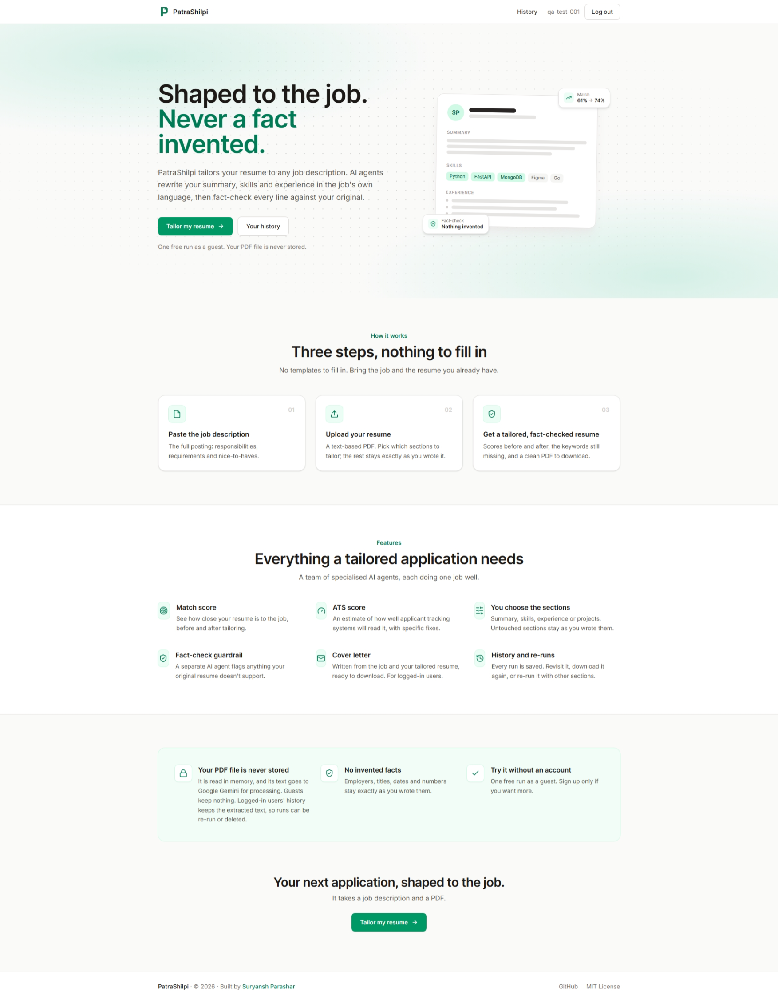
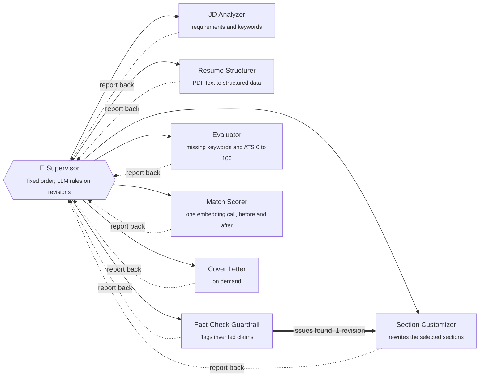
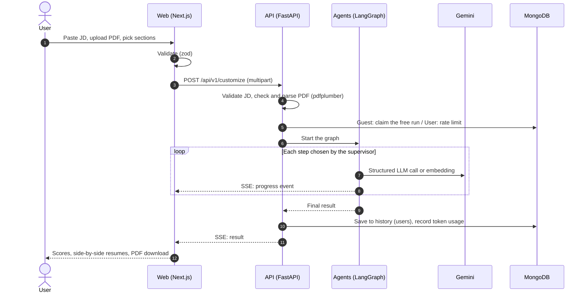
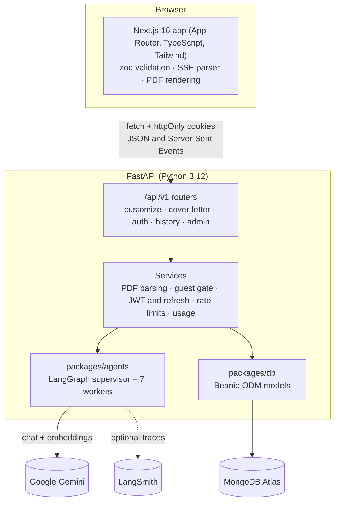
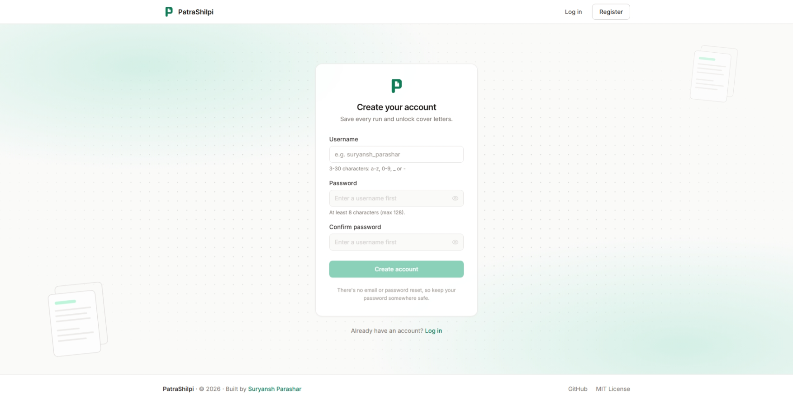
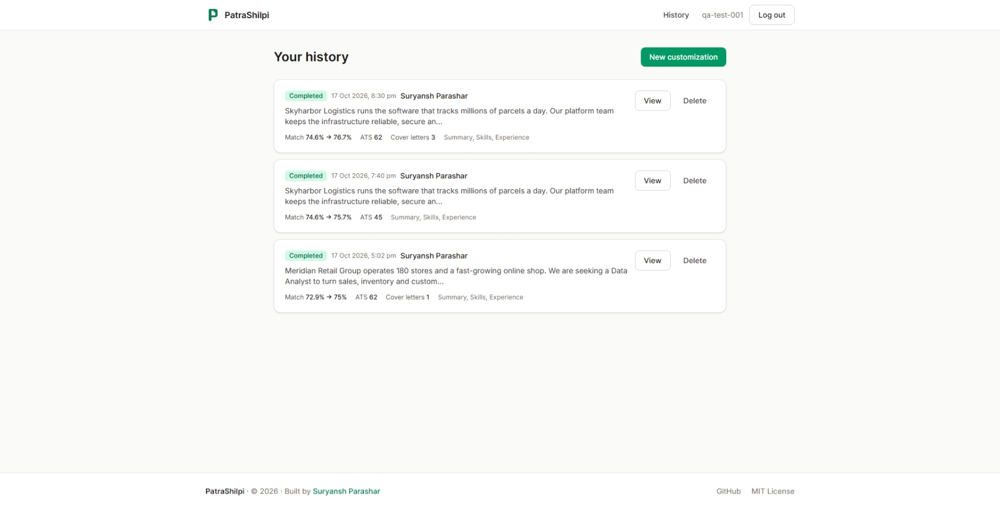

<div align="center">

<picture>
  <source media="(prefers-color-scheme: dark)" srcset="docs/brand/patrashilpi-lockup-dark.svg">
  
</picture>

**Shaped to the job. Never a fact invented.**

Paste a job description, upload your resume, and get a version tailored to that job.
It is rewritten by a team of AI agents, fact-checked against your original, and scored before and after.

[**Live demo**](https://patrashilpi.suryanshparashar.com) · [Demo video](https://patrashilpi.suryanshparashar.com/demo-video) · [Report a bug](https://github.com/suryanshparashar/patra-shilpi/issues)

[](LICENSE)




</div>

---

## Contents

- [Why this exists](#why-this-exists)
- [Features](#features)
- [How it works](#how-it-works)
- [Architecture](#architecture)
- [Tech stack](#tech-stack)
- [LLM provider and model](#llm-provider-and-model)
- [Getting started](#getting-started)
- [Configuration](#configuration)
- [API reference](#api-reference)
- [Project structure](#project-structure)
- [Security and privacy](#security-and-privacy)
- [Admin panel](#admin-panel)
- [Deployment](#deployment)
- [Known limitations and trade-offs](#known-limitations-and-trade-offs)
- [Screenshots](#screenshots)
- [Development](#development)
- [License](#license)

---

## Why this exists

Tailoring a resume for every application works, but it is slow and easy to get wrong. People
either send the same resume everywhere, or they "optimize" it into claims they can't back up in
an interview.

PatraShilpi takes the tedious part off your hands. It reads the job description the way an
applicant tracking system (ATS) and a hiring manager do, then reworks your summary, skills,
experience and projects to match. The one rule it never breaks is that **it cannot invent
facts**. Every rewrite is checked against your original resume before you see it.

## Features

**The core flow**

- 📝 **Job description input:** paste the full posting, with a live character counter and validation (50 to 10,000 characters).
- 📄 **Resume upload:** a PDF up to 5 MB, by drag and drop or browsing. The file name and size are shown, and the text is extracted on the server.
- 🤖 **AI customization:** the summary is rewritten for the role, relevant skills are highlighted and reordered, and experience and project bullets are rephrased using the job's keywords.
- 🔍 **Missing keywords:** terms from the job description that your resume doesn't show, with honest advice on whether and where to add each one.
- ⬇️ **PDF download:** a clean, single-column, ATS-friendly PDF, generated in the browser.
- 🛡️ **Clear errors:** wrong file type, oversized or scanned PDFs, and empty or invalid input each get a specific message. AI failures are retried and degrade gracefully.

**Beyond the brief**

| | Feature | What it does |
|---|---|---|
| 🎯 | **Match score** | Semantic similarity between resume and job, **before and after** customization (Gemini embeddings). |
| ✅ | **ATS score** | A 0 to 100 estimate of ATS-friendliness, with strengths and specific fixes. |
| 🧩 | **Section-wise customization** | Choose which of Summary, Skills, Experience and Projects to change. Everything else stays exactly as you wrote it. |
| ✉️ | **Cover letter** | Generated on demand from the job and your tailored resume. Streams in, then downloads as a PDF. |
| ⚡ | **Streaming** | A live step-by-step timeline while the agents work, over Server-Sent Events. |
| 🔐 | **Accounts and history** | Username and password login. Every run is saved, with view, re-download, **re-run with different sections**, and delete. |
| 🧪 | **Fact-check guardrail** | A dedicated agent flags anything the original resume doesn't support, and triggers one automatic revision. |
| 📊 | **Admin panel** | Users, guests, runs, LLM calls, tokens and estimated cost. |

## How it works

Customization is a **LangGraph supervisor-and-workers graph**. The order of the specialists is
**fixed in code** (so no model call is spent deciding it), and each runs once per turn. The LLM
supervisor is consulted for the one real judgement: when the fact-check flags the draft, should it
be sent back for a revision? A clean run therefore costs **6 model requests** (5 chat plus 1
embedding); a revision adds 3, and a cover letter after a run adds 1.



**What makes the output trustworthy**

1. **Grounded rewriting.** The customizer may change wording, emphasis and order, never facts. Employers, titles, dates, degrees and metrics stay as written. It can use the job's terminology only for skills you already show (`JS` becoming `JavaScript` is allowed; claiming a new tool is not).
2. **An independent fact-check.** A separate guardrail agent compares the draft with your original. It flags new skills, changed numbers, and inflated scope ("contributed" turning into "led").
3. **One self-correction loop.** If the guardrail finds real problems, the supervisor sends the flagged items back to the customizer for one revision. Anything still unresolved is shown to you to review.
4. **Structured outputs everywhere.** Every agent returns schema-validated JSON (Pydantic), so the UI never parses free text. A code-level safety net also keeps the original section if a rewrite ever drops or adds a whole role.
5. **Resilience.** Gemini calls retry on rate limits, server errors and timeouts (3 attempts, exponential backoff with jitter). A step that still fails is recorded, and the rest of the run carries on, so you get **partial results** instead of a blank error page.

All the system prompts are versioned plain-text files in
[`packages/agents/src/agents/prompts/`](packages/agents/src/agents/prompts/).

**One request, end to end**



## Architecture



It's a monorepo with one deployable per app and shared packages. The PRD's `frontend/` and
`backend/` correspond to `apps/web` and `apps/api`:

| Path | What it is |
|---|---|
| `apps/web` | Next.js frontend: form, live progress, results, history, admin |
| `apps/api` | FastAPI backend: validation, PDF parsing, auth, streaming, persistence |
| `packages/agents` | The LangGraph graph, LangChain agents, prompts, retries and usage tracking |
| `packages/db` | MongoDB models (Beanie) and the connection helper |

The Python side is a single **uv workspace**, with one lockfile for the whole repo, so the
packages can never drift to different dependency versions.

## Tech stack

| Layer | Choice | Why |
|---|---|---|
| Frontend | **Next.js 16** (App Router), React 19, TypeScript (strict) | Required by the brief; modern routing and streaming |
| Styling | **Tailwind CSS v4** | Fast, consistent, no component-library lock-in |
| Validation | **zod** | One schema validates forms and every API response |
| PDF export | **@react-pdf/renderer** | Generated in the browser, so the server stores nothing |
| Backend | **FastAPI** | Async, typed, Pydantic validation, auto-generated docs |
| Orchestration | **LangGraph** | An explicit, inspectable agent graph with streaming |
| Agents | **LangChain** + `langchain-google-genai` | Structured output and a unified chat/embedding interface |
| LLM | **Google Gemini** | Strong structured output, generous free tier |
| Observability | **LangSmith** (optional) | A full trace of every agent and LLM call |
| Database | **MongoDB Atlas** + **Beanie** | Document-shaped data (resumes, runs), a Mongoose-like ODM |
| PDF parsing | **pdfplumber** | MIT-licensed, layout-aware text extraction |
| Auth | **PyJWT** + **bcrypt** | Short-lived access JWTs plus rotating refresh tokens |
| Guest limit | **ThumbmarkJS** (MIT) | A browser fingerprint, hashed server-side |
| Tooling | **uv**, ruff, mypy (strict), ESLint, Prettier | Fast installs and strict checks on both sides |

## LLM provider and model

| Purpose | Provider | Model | Configured by |
|---|---|---|---|
| All chat agents (one model for everything) | Google Gemini | `gemini-flash-lite-latest` (current setup) | `GEMINI_MODEL` (required, no default) |
| Match score embeddings | Google Gemini | `gemini-embedding-001` | `GEMINI_EMBEDDING_MODEL` |

The chat model is deliberately configured only through the environment, so you can switch to
any Gemini model your key has access to without touching code. A clean run makes **6 Gemini
requests** (JD analysis, resume structuring, customizing, fact-check, keywords and ATS in one
call, and one embedding call for both match scores). A revision adds 3, and a cover letter adds 1.

## Getting started

> **For evaluators:** open [`/qa`](https://patrashilpi.suryanshparashar.com/qa) to be signed in
> as the test user `qa-test-001` instantly, with no form. You can also try one run as a guest,
> or register your own account.

### Prerequisites

- **Python 3.12** and **[uv](https://docs.astral.sh/uv/)**
- **Node.js 22+** and npm
- A **MongoDB Atlas** cluster (the free tier works). Allow your IP under *Network Access*.
- A **Gemini API key** from [Google AI Studio](https://aistudio.google.com/)
- Optional: a **LangSmith** API key for traces

### 1. Clone and install

```bash
git clone https://github.com/suryanshparashar/patra-shilpi.git
cd patra-shilpi

uv sync --all-packages          # Python: API + shared packages in one workspace
cd apps/web && npm install      # Web
```

> On Windows, if `uv` isn't on your PATH, use `py -3.12 -m uv ...` instead.

### 2. Configure

```bash
cp apps/api/.env.example apps/api/.env
```

Fill in at least these five values (the full list is under [Configuration](#configuration)):

```ini
MONGODB_URI=mongodb+srv://<user>:<password>@<cluster>.mongodb.net/
GOOGLE_API_KEY=your-gemini-key
GEMINI_MODEL=your-gemini-model
GUEST_HASH_SECRET=<random secret>
JWT_SECRET=<random secret>
```

Generate each secret with `python -c "import secrets; print(secrets.token_hex(32))"`.

The web app talks to `http://localhost:8000` by default. Only create `apps/web/.env.local`
(from `.env.example`) if your API runs somewhere else.

### 3. Run

```bash
# Terminal 1: API on http://localhost:8000 (auto-reloads on changes)
uv run --package api dev

# Terminal 2: web on http://localhost:3000
cd apps/web && npm run dev
```

### 4. Check it works

- http://localhost:8000/api/v1/healthcheck returns `"database": "connected"`.
- http://localhost:8000/api/v1/docs has interactive API docs.
- http://localhost:3000 is the landing page, and http://localhost:3000/customize is the app. Sample job descriptions are in [`tests/data/jd.txt`](tests/data/jd.txt).

## Configuration

All backend settings come from `apps/api/.env`. A key with no value (`KEY=`) counts as unset.

<details>
<summary><b>Core</b></summary>

| Variable | Required | Default | Description |
|---|:---:|---|---|
| `ENVIRONMENT` | | `development` | Shown by the healthcheck |
| `DEVLOG` | | auto | Step-by-step `[API]` `[AGENT]` `[WORKER]` `[LLM]` `[EMBEDDINGS]` lines in the API console. Empty: on in development, off in production |
| `CORS_ORIGINS` | | `["http://localhost:3000"]` | JSON list of allowed web origins |
| `MONGODB_URI` | ✅ | | MongoDB connection string |
| `MONGODB_DB` | | `patrashilpi_db` | Database name |

</details>

<details>
<summary><b>AI agents</b></summary>

| Variable | Required | Default | Description |
|---|:---:|---|---|
| `GOOGLE_API_KEY` | ✅ | | Gemini API key |
| `GEMINI_MODEL` | ✅ | | Chat model used by every agent |
| `GEMINI_EMBEDDING_MODEL` | | `gemini-embedding-001` | Embedding model for the match score |
| `LLM_MAX_ATTEMPTS` | | `3` | Attempts per Gemini call |
| `LLM_RETRY_BASE_DELAY` | | `1.0` | Backoff base in seconds (1s, 2s, 4s, plus jitter) |
| `LLM_TIMEOUT_SECONDS` | | `60` | Timeout per call |
| `LANGSMITH_TRACING` | | `false` | Turn LangSmith tracing on or off (same setup in dev and prod) |
| `LANGSMITH_API_KEY` | | | LangSmith key |
| `LANGSMITH_PROJECT` | | `patrashilpi` | LangSmith project name |
| `LANGSMITH_AGENT_ID` · `LANGSMITH_AGENT_ENVIRONMENT` | | | Group traces under an agent in LangSmith's Agents view |
| `LANGSMITH_ENDPOINT` | | US default | Your workspace's regional endpoint (e.g. `https://apac.api.smith.langchain.com`) |

</details>

<details>
<summary><b>Auth, cookies and limits</b></summary>

| Variable | Required | Default | Description |
|---|:---:|---|---|
| `JWT_SECRET` | ✅ | | Signs access and admin JWTs |
| `GUEST_HASH_SECRET` | ✅ | | Salts guest hashes and signs the device cookie |
| `ACCESS_TOKEN_MINUTES` | | `30` | Access token lifetime |
| `REFRESH_TOKEN_DAYS` | | `14` | Refresh token lifetime (rotated on every use) |
| `COOKIE_DOMAIN` | | | Leave empty (host-only cookies on the API). Set a parent domain only if another subdomain must share the cookies |
| `COOKIE_SECURE` | | `false` | `true` in production (HTTPS) |
| `COOKIE_SAMESITE` | | `lax` | `lax`, `strict` or `none` |
| `RATE_LIMIT_PER_HOUR` | | `10` | Customizations and cover letters per user per hour (each) |
| `QA_LOGIN_USERNAME` | | | Existing account that `/qa` signs visitors into (empty disables `/qa`) |

</details>

<details>
<summary><b>Admin panel</b></summary>

| Variable | Required | Default | Description |
|---|:---:|---|---|
| `ADMIN_KEYWORD` | | | Secret keyword for admin login (empty disables it) |
| `ADMIN_SESSION_MINUTES` | | `60` | Admin session lifetime |
| `LLM_PRICE_INPUT_PER_MILLION` | | | USD per 1M input tokens, for cost estimates |
| `LLM_PRICE_OUTPUT_PER_MILLION` | | | USD per 1M output tokens |

</details>

**Web** (`apps/web/.env.local`): `NEXT_PUBLIC_API_URL` is the API origin *without* `/api/v1`
(default `http://localhost:8000`). `NEXT_PUBLIC_DEMO_VIDEO_ID` is the YouTube video ID (or link)
shown on `/demo-video`; leave it empty to show "coming soon". `NEXT_PUBLIC_NOTICE_BANNER=true`
shows a dismissible site-wide notice banner. All three are baked in at build time.

## API reference

Every backend route lives under **`/api/v1`**. Errors always have the same shape:
`{"error": {"code", "message", "details"}}`. Interactive docs are at `/api/v1/docs`.

| Method | Path | Auth | Description |
|---|---|---|---|
| `GET` | `/healthcheck` | | Service and database status |
| `POST` | `/customize` | guest or user | Multipart: `jd_text`, `sections[]`, `resume` (PDF), `fingerprint`. **SSE stream** |
| `POST` | `/cover-letter` | user | JSON: `jd_text`, `customized_resume`, `run_id?`. **SSE stream** |
| `POST` | `/auth/register` | | Create an account and log in |
| `POST` | `/auth/login` | | Log in (sets httpOnly cookies) |
| `POST` | `/auth/refresh` | refresh cookie | Rotate the session |
| `POST` | `/auth/logout` | | End the session |
| `GET` | `/auth/me` | user | Current user |
| `GET` | `/history` | user | Saved runs, newest first (`?cursor=`) |
| `GET` | `/history/{id}` | user | One saved run |
| `DELETE` | `/history/{id}` | user | Delete a run |
| `POST` | `/history/{id}/rerun` | user | Re-run with other `sections[]`. **SSE stream** |
| `POST` | `/admin/login` · `/admin/login/keyword` | | Admin login (password or keyword) |
| `GET` | `/admin/stats` · `/admin/users` | admin | Dashboard totals, users with run counts |

**Streaming events:** `progress` (step started, done or failed), `token`, `token_reset` (a retry
began), then exactly one `result` or `error`.

## Project structure

```text
.
├── apps/
│   ├── api/                      FastAPI backend
│   │   └── src/api/
│   │       ├── routers/          customize, cover_letter, auth, history, admin, health
│   │       ├── services/         pdf_parser, guest_gate, auth, security, history, usage, ...
│   │       ├── config.py         settings from .env (pydantic-settings)
│   │       └── main.py           app, lifespan, error handlers
│   └── web/                      Next.js frontend
│       └── src/
│           ├── app/              / (landing), /customize, /results, /login, /register, /history, /admin
│           ├── components/       form, results, history, admin, ui
│           ├── context/          run and auth state
│           ├── lib/              API client, SSE parser, zod schemas, session refresh
│           └── pdf/              resume and cover letter PDF templates
├── packages/
│   ├── agents/src/agents/        graph, supervisor, workers/, prompts/*.md, retry, usage
│   └── db/src/db/                Beanie models (+ admin/ collections)
├── tests/data/jd.txt             sample job descriptions
├── pyproject.toml / uv.lock      uv workspace
└── dev-docs/PRD.md               the original brief
```

## Security and privacy

- **Your PDF is never stored.** It is parsed in memory and only the extracted text is kept, and only for logged-in users' history.
- **Sessions:** a short-lived JWT access token plus an opaque refresh token, both in `httpOnly` cookies. The refresh token is stored only as a hash, is single-use, and its cookie is only sent to `/api/v1/auth`.
- **Passwords:** bcrypt over a SHA-256 pre-hash, so long passwords are not silently cut at bcrypt's 72-byte limit. Login says whether the username or the password was wrong (sign-up already reveals taken usernames).
- **Brute force:** 5 failed logins per 15 minutes (per IP and username), 10 sign-ups per hour per IP, and the same lock on admin login.
- **Guests get one free run.** Guests are recognised by a signed device cookie and a browser fingerprint, stored only as salted HMAC hashes and deleted after 90 days. A run that fails doesn't use up the free run.
- **Admin is separate.** It has its own cookie scoped to `/api/v1/admin`. User tokens and admin tokens are not interchangeable.

## Admin panel

Open `/admin/login`. There are two ways in, and both reach the same single admin:

1. **Secret keyword:** set `ADMIN_KEYWORD` in `.env`.
2. **Username and password:** insert a document into the `admins` collection with `username`, `password_hash` and `created_at`. Generate the hash (same scheme as user passwords) with:

   ```bash
   uv run python -c "import asyncio; from api.services.security import hash_password; print(asyncio.run(hash_password('YOUR_PASSWORD')))"
   ```

The dashboard shows registered users, guest users, resume runs, cover letters, LLM and
embedding calls, tokens, and estimated cost, plus a paginated list of users with their run
counts. Numbers come from per-call usage records, so they don't change when users delete their
history.

## Deployment

Production runs as two **Render Web Services** (not Static Sites: the Next.js app needs its
server for server rendering).

| | Web (Next.js) | API (FastAPI) |
|---|---|---|
| Runtime | Node | Python |
| Root directory | `apps/web` | repository root (the uv workspace needs `packages/`) |
| Build command | `npm install && npm run build` | `uv sync --frozen --no-dev --package api && uv cache prune --ci` |
| Start command | `npm run start` | `uv run --no-sync --package api uvicorn api.main:app --host 0.0.0.0 --port $PORT` |
| Domain | `https://patrashilpi.suryanshparashar.com` | `https://<api-host>` |

- **Python version:** set `PYTHON_VERSION=3.12.x` on the API service; the project requires 3.12.
- **API URL:** set `NEXT_PUBLIC_API_URL=https://<api-host>` on the web service *before* it builds; it is baked into the bundle.
- **CORS:** `CORS_ORIGINS=["https://patrashilpi.suryanshparashar.com"]`.
- **Cookies:** leave `COOKIE_DOMAIN` empty and set `COOKIE_SECURE=true`. With the API on a
  subdomain of the same domain, use `COOKIE_SAMESITE=lax`. If the API stays on
  `*.onrender.com`, the cookies become third-party: use `COOKIE_SAMESITE=none`, and expect
  browsers that block third-party cookies (such as Safari) to drop the login.

## Known limitations and trade-offs

| Area | Limitation | Why / mitigation |
|---|---|---|
| Input | **PDF only**, text-based, up to 5 pages | Scanned PDFs are detected and rejected with a clear message (no OCR) |
| Match score | **Raw cosine similarity × 100**, so most resumes land between 55 and 85 | Honest rather than rescaled. Inputs are truncated to 7,000 characters to fit the embedding model |
| ATS score | **Estimated by an LLM** from text only | There's no real ATS to test against. The prompt asks for calibrated, specific feedback |
| Cost and latency | **6 Gemini requests** per clean run (5 chat + 1 embedding); a revision adds 3 | The step order is fixed in code and the supervisor LLM only decides revisions. Free-tier rate limits are absorbed by retries |
| Rate limits | **In-memory**, per process | Fine for a single instance. Multiple instances would need Redis or Mongo-backed limits |
| Guest limit | Bypassable by a different browser or by clearing data | Fingerprinting is best-effort by design. Logged-in use is the real path |
| History | Stores the ATS *score* but not the full notes, keyword gaps or fact-check flags | A scope decision. The customized resume, scores and cover letters are kept |
| Accounts | No password reset (no email) | Usernames, not emails, by design. The register page says so |
| Streaming UI | Shows a step timeline, not live tokens | The customizer streams JSON, so a timeline reads better |
| Single model | Every agent uses one `GEMINI_MODEL` | Simpler to run. Cost estimates assume that one model's price |
| Testing | **No automated test suite** | Verified manually and with throwaway harnesses during development |
| Hosting | Free-tier services sleep when idle | The first request after a while can be slow (a cold start) |

**Not built (from the optional list):** diff view and multiple-version comparison.

## Screenshots


**The landing page:** what it does, how it works, and what happens to your data.

| | |
|:---:|:---:|
|  |  |
| **Sign up with a username and password** | **History: every run with its scores, sections and cover letters** |

🎬 **Demo video:** [watch the walkthrough](https://patrashilpi.suryanshparashar.com/demo-video)

## Development

```bash
# Python: lint, format check, strict type check
uv run ruff check . && uv run ruff format --check . && uv run mypy apps/api/src packages/db/src packages/agents/src

# Web: lint, types, formatting, production build
cd apps/web && npm run lint && npm run typecheck && npm run format:check && npm run build
```

| Command | What it does |
|---|---|
| `uv run --package api dev` | API with auto-reload (watches `apps/api` and `packages/`) |
| `npm run dev` | Web dev server |
| `npm run format` | Format the web code with Prettier |
| `uv run ruff format .` | Format the Python code |

## License

[MIT](LICENSE) © 2026 Suryansh Parashar
